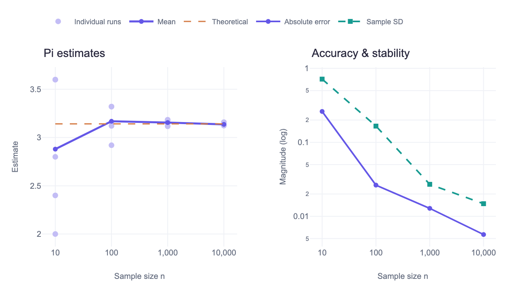
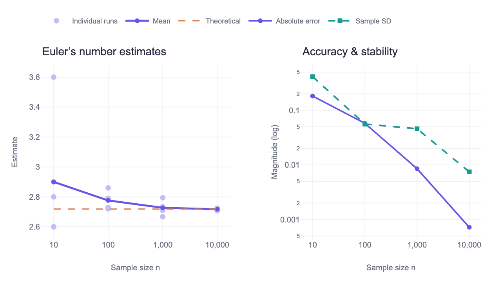

# Monte Carlo Studio

**Doğukan Ercan · DengeX**

Rastgele denemelerle π ve Euler sayısı e’yi tahmin eden, Go ile geliştirilmiş yerel bir simülasyon uygulaması. Örneklem büyüklüğünü, tekrar sayısını ve seed değerini değiştirerek tahminlerin doğruluğunu ve kararlılığını inceleyebilirsiniz.

Hesaplama Go’da, grafikler tarayıcıda çalışır. Python yalnızca isteğe bağlı başlatıcıdır. Uygulama dosyaları ve çalışma zamanı kütüphaneleri derlenmiş programa gömülüdür; kullanım sırasında internet bağlantısı gerekmez.

[Hazır paketi indir](https://github.com/dengexco/monte-carlo-studio/releases/latest) · [Deney raporu](docs/Monte-Carlo-Report.pdf) · [Kullanım ve kod rehberi](read.md)

## Neler yapabilirsiniz

- π ve e deneylerini ayrı ayrı veya birlikte çalıştırabilirsiniz.
- Örneklem büyüklüğünü, tekrar sayısını ve rastgele sayı başlangıcını belirleyebilirsiniz.
- Her tekrarın sonucunu, ortalamayı, mutlak hatayı ve örneklem standart sapmasını görebilirsiniz.
- Grafiklerde yakınlaştırma yapabilir ve PNG indirebilirsiniz.
- Sonuçları CSV ve JSON olarak kaydedebilirsiniz.
- Docs bölümünde yöntemleri, ders biçimindeki sonuç tablolarını ve kütüphaneleri inceleyebilirsiniz.

## Deneylerin mantığı

**π:** Birim kareye uniform noktalar yerleştirilir. `x² + y² ≤ 1` koşulunu sağlayan noktaların oranı dörtle çarpılır.

**e:** Uniform sayılar, toplamları 1’i aşana kadar eklenir. Gerekli sayı adedi kaydedilir. Bu işlem birçok kez tekrarlanır ve adetlerin ortalaması alınır.

Varsayılan ayarlar her iki deney için `n = 10, 100, 1000, 10000` ve her n için beş tekrardır. Toplam 40 tahmin üretilir. Go PCG üreteci sayesinde aynı ayarlar aynı sonuçları verir; her tekrar ayrı bir başlangıç akışı kullanır.

## Uygulamadan alınan örnek çıktı

20 Ekim 2026 tarihli kayıt, seed `20261019` ile tek bir uygulama çalışmasından alınmıştır. N=10.000 için beş tekrarın ortalaması:

| Deney | Ortalama | Mutlak hata | Örneklem SD |
|---|---:|---:|---:|
| π | 3,135920 | 0,005673 | 0,014809 |
| e | 2,717560 | 0,000722 | 0,007466 |





Grafikler doğrudan uygulamadan indirilmiştir. [Ham veriler ve tekrar günlüğü](results/2026-10-20) raporla aynı çalışmaya aittir. Büyük n genellikle daha kararlı tahminler sağlar; her tekil çalışmada hata azalması garanti değildir.

## Hızlı başlangıç

[Releases](https://github.com/dengexco/monte-carlo-studio/releases/latest) bölümünden ZIP’i indirip tamamını çıkarın. Hazır program **macOS Apple Silicon / ARM64** içindir. `Monte Carlo.command` dosyasını açabilir veya proje klasöründe çalıştırabilirsiniz:

```sh
./bin/monte-carlo-studio
```

Tarayıcı açılır ve varsayılan deney başlar. Terminalde `Ctrl+C` sunucuyu kapatır. Sonuçlar bellekte tutulur; kapatmadan önce indirin.

## Kaynak koddan çalıştırma

Go 1.24 veya üzeri gerekir:

```sh
git clone https://github.com/dengexco/monte-carlo-studio.git
cd monte-carlo-studio
go build -trimpath -o bin/monte-carlo-studio .
./bin/monte-carlo-studio
```

Windows için `go build -trimpath -o bin/monte-carlo-studio.exe .` kullanın. Derlenmiş dosyalar işletim sistemi ve işlemci mimarisine özeldir.

Python başlatıcısı da kullanılabilir:

```sh
python3 odev.py
```

Bu dosya Go uygulamasını çalıştırır; simülasyonu Python’da hesaplamaz ve Go programını kendisi derlemez.

| Seçenek | İşlev |
|---|---|
| `--port 8765` | Sabit yerel port kullanır. Varsayılan olarak boş bir port seçilir. |
| `--no-browser` | Tarayıcıyı otomatik açmaz. |
| `--no-gui` | Varsayılan deneyi terminalde çalıştırır ve JSON kaydeder. |

## Geliştirme

React bileşenleri değiştiğinde ön yüzü, ardından Go programını yeniden derleyin:

```sh
npm ci
npm run build
go build -trimpath -o bin/monte-carlo-studio .
```

Hazır ön yüz dosyası depoda bulunur. Node.js yalnızca ön yüzü yeniden derlemek için gerekir. HTML, CSS veya Go değişiklikleri sonrasında da Go derlemesi ve uygulamanın yeniden başlatılması gerekir.

```sh
go test -race ./...
go vet ./...
```

Testler algoritma sınırlarını, tekrar üretilebilirliği, iptali, ayar doğrulamasını ve HTTP API davranışını kapsar.

## Proje düzeni

| Konum | İçerik |
|---|---|
| `main.go` | Yerel sunucu, API ve dışa aktarma |
| `internal/simulation` | Hesaplama motoru ve testleri |
| `frontend` | UI TripleD’den uyarlanan React bileşenleri |
| `assets` | Yerel arayüz, Plotly ve görseller |
| `docs` | Proje kapsamı, PDF raporu ve kütüphane listesi |
| `results/2026-10-20` | Kayıtlı çalışmanın veri ve grafikleri |
| `scripts/build_report.py` | Kayıtlı verilerden PDF oluşturma yardımcısı |

## Teknolojiler ve kaynaklar

Go standart kütüphanesi, React, Base UI, Framer Motion ve Plotly kullanılır. UI TripleD’nin Native Tabs ve Native Magnetic bileşenleri projeye uyarlanmıştır. DengeX logosu resmi site varlığından alınmıştır.

Sürümler [kütüphane listesinde](docs/Kutuphaneler.md), kaynaklar [SOURCES.md](assets/vendor/SOURCES.md) içinde yer alır. Üçüncü taraf lisansları `licenses` ve `assets/vendor` klasörlerinde korunur. Bu lisanslar DengeX marka varlıklarına otomatik olarak uygulanmaz.

## Proje sahibi ve kullanım notu

Proje sahibi: **Doğukan Ercan**. GitHub hesabı: [DengeX](https://github.com/dengexco). Web: [dengex.com](https://dengex.com).

Proje ve belgeler AI yardımıyla hazırlanmıştır. Matematiksel yöntemler paylaşılan ders notlarıyla karşılaştırılmıştır. İlgili dersin AI kullanımı ve programlama dili koşulları ayrıca geçerlidir; bu depo bağımsız öğrenci çalışması olarak sunulmaz.
